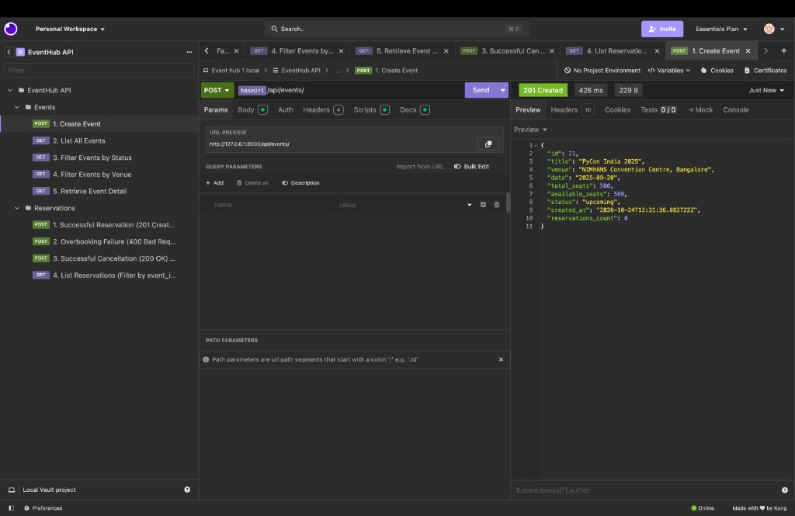
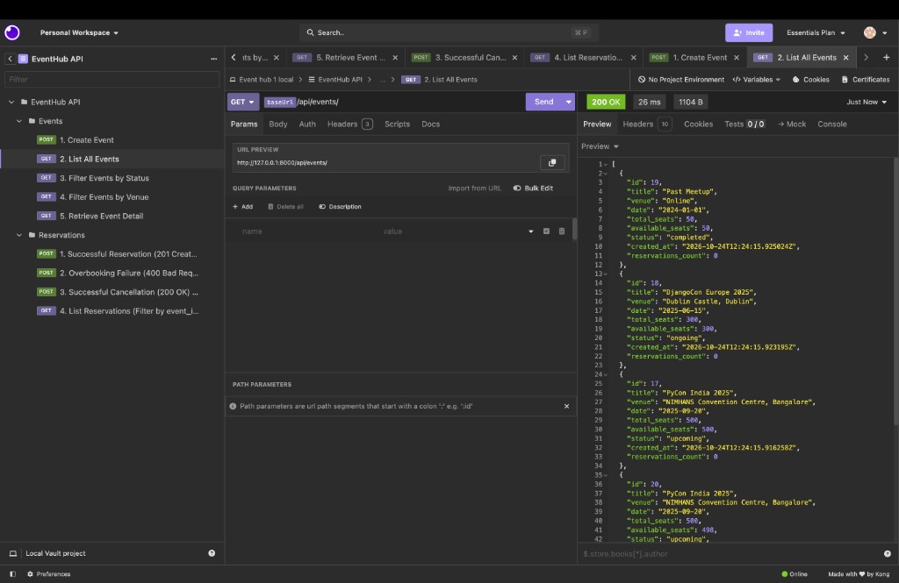
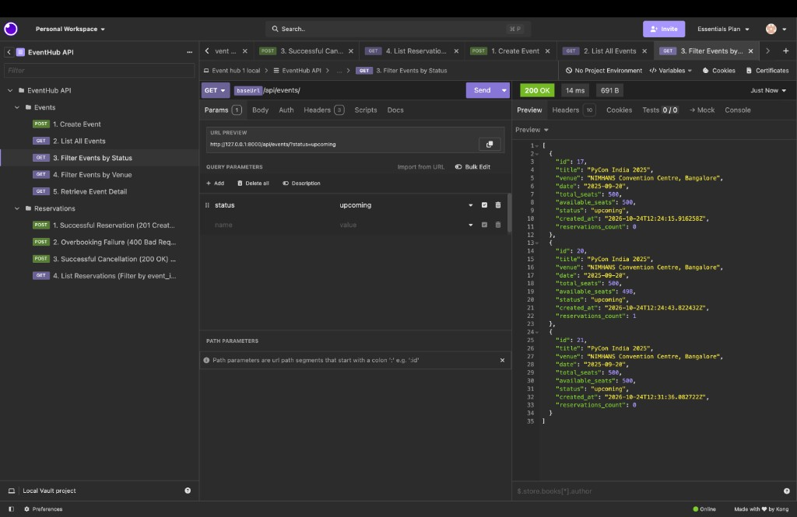
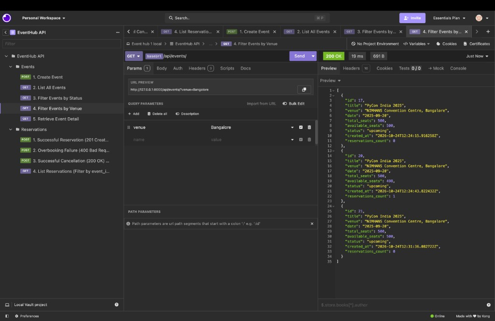
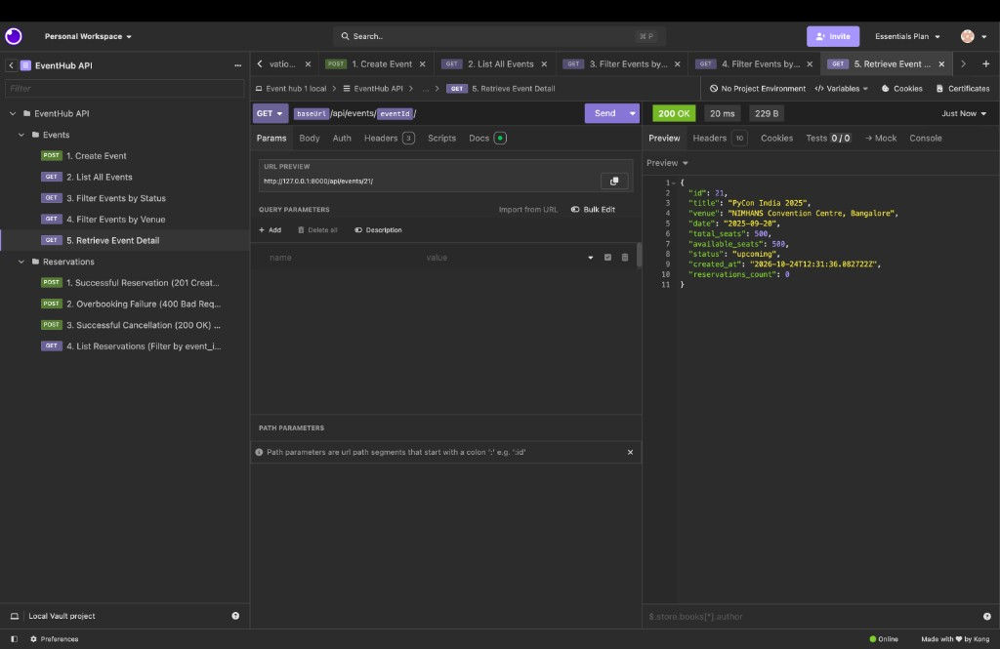
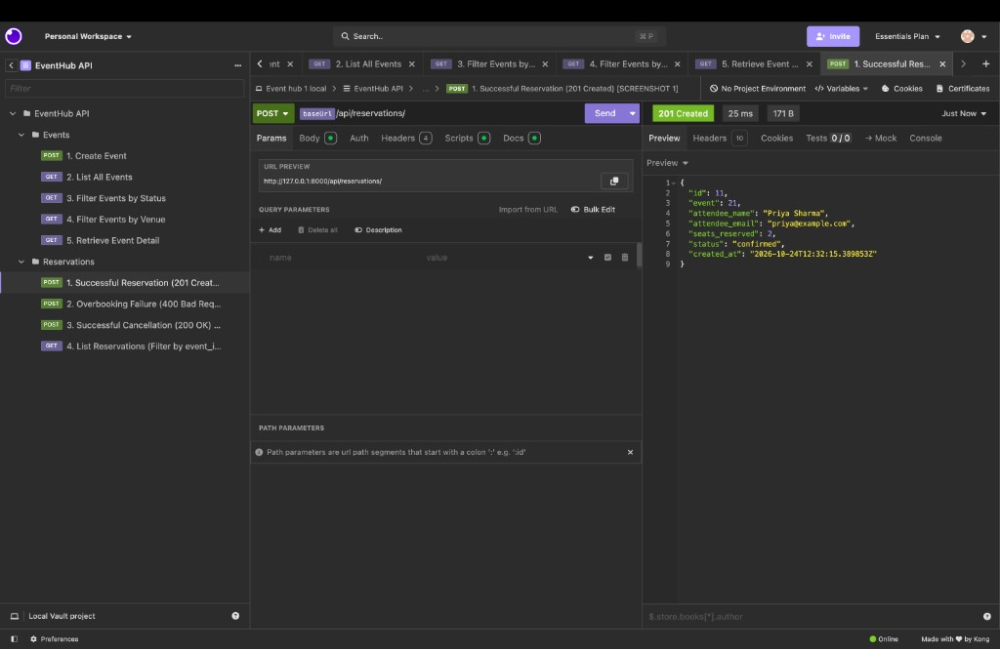
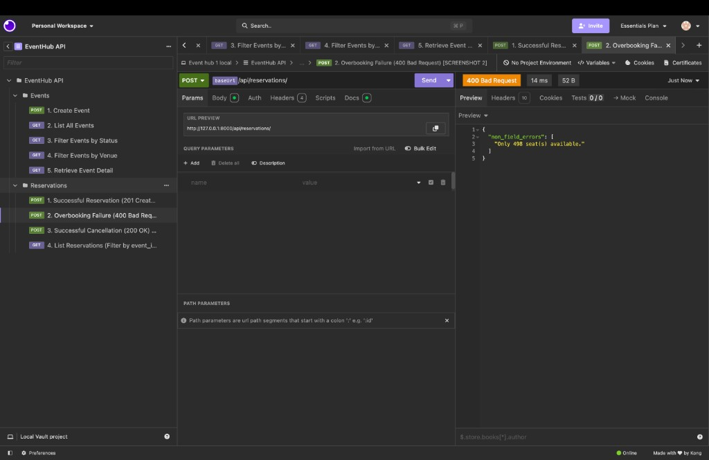
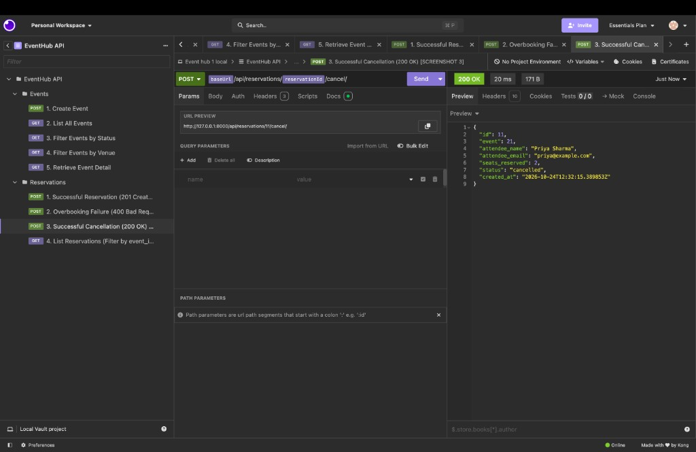
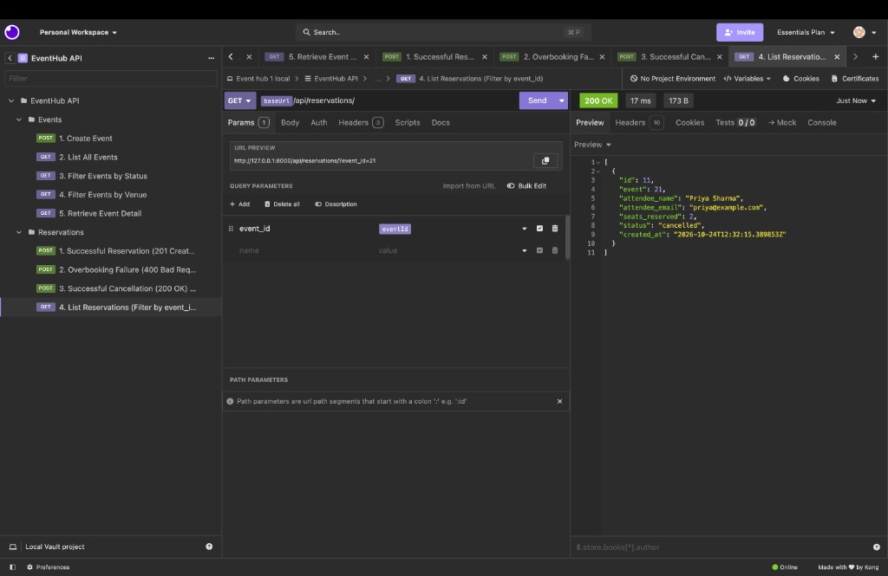

# EventHub - Scalable Event Ticketing Platform API

EventHub is an enterprise-grade backend REST API for an event ticketing platform built with **Django**, **Django REST Framework (DRF)**, **PostgreSQL 16**, **Redis 7**, and **Docker**.

Users can:
- Browse and filter events by status and venue with sub-millisecond cached responses
- Reserve seats with concurrency-safe row-level locking (`select_for_update`) and automatic availability deduction
- Cancel reservations with automatic seat restoration and idempotent error handling
- Benefit from automatic cache invalidation, API rate-limiting/throttling against bot scalpers, and structured JSON error responses

---

## Table of Contents
1. [Tech Stack](#tech-stack)
2. [Architecture & Scalability Design](#architecture--scalability-design)
3. [Project Structure](#project-structure)
4. [Setup & Running Instructions](#setup--running-instructions)
   - [Option A: Running with Docker, PostgreSQL & Redis (Recommended)](#option-a-running-with-docker-postgresql--redis-recommended)
   - [Option B: Running Locally with Python Virtualenv (SQLite & LocMem Fallback)](#option-b-running-locally-with-python-virtualenv-sqlite--locmem-fallback)
5. [Validation & Exception Handling System](#validation--exception-handling-system)
6. [Redis Caching & Scalability Layer](#redis-caching--scalability-layer)
7. [API Endpoints Reference](#api-endpoints-reference)
8. [Design Decisions](#design-decisions)
9. [Running Automated Tests](#running-automated-tests)
10. [Postman Guide (Screenshots Checklist)](#postman-guide-screenshots-checklist)

---

## Tech Stack
- **Python** 3.13
- **Django** 6.1
- **Django REST Framework** 3.18
- **PostgreSQL** 16 (Alpine) via `psycopg2-binary`
- **Redis** 7 (Alpine) via `django-redis` & `redis`
- **Docker & Docker Compose** for container orchestration
- **SQLite3 & LocMemCache** for automated, zero-config local development

---

## Architecture & Scalability Design

```text
                               [Client / Postman]
                                       │
                                       ▼
                       ┌───────────────────────────────┐
                       │   RequestLoggingMiddleware    │
                       └───────────────┬───────────────┘
                                       │
                                       ▼
                       ┌───────────────────────────────┐
                       │  DRF Throttling (Redis-backed)│ ◄── Rate limiting (120/min anon, 1000/min user)
                       └───────────────┬───────────────┘
                                       │
                       ┌───────────────┴───────────────┐
              [Read Requests: GET]            [Write Requests: POST/PATCH]
                       │                                       │
                       ▼                                       ▼
            ┌─────────────────────┐                 ┌─────────────────────┐
            │   Redis Cache L1    │                 │ transaction.atomic()│
            │ (Sub-ms event data) │                 │ + select_for_update │
            └──────────┬──────────┘                 └──────────┬──────────┘
                       │ (Cache Miss)                          │ (Row Locked)
                       ▼                                       ▼
            ┌─────────────────────┐                 ┌─────────────────────┐
            │   PostgreSQL DB     │                 │   PostgreSQL DB     │
            │  (Persistent Store) │                 │  (ACID DB Mutation) │
            └─────────────────────┘                 └──────────┬──────────┘
                                                               │
                                                               ▼
                                                    ┌─────────────────────┐
                                                    │ Invalidate Events   │
                                                    │ Cache in Redis      │
                                                    └─────────────────────┘
```

---

## Project Structure

```text
Event-hub/
├── Dockerfile                  # Container definition (Python 3.13-slim)
├── docker-compose.yml          # PostgreSQL 16, Redis 7 & Django web service
├── entrypoint.sh               # DB & Redis readiness probes, migrations & startup
├── .env.example                # Environment variables template
├── requirements.txt            # Python dependencies (Django, DRF, psycopg2, django-redis)
├── postman_collection.json     # Importable Postman test collection
├── docs/screenshots/           # API testing reference screenshots (Postman/Insomnia)
├── test_eventhub.py            # Standalone API, validation & caching verification suite
├── manage.py
├── README.md
├── eventhub/
│   ├── __init__.py
│   ├── asgi.py
│   ├── settings.py             # Configured for PostgreSQL/SQLite & Redis/LocMemCache
│   ├── urls.py                 # Root router with /api/ prefix
│   └── wsgi.py
└── events/
    ├── __init__.py
    ├── admin.py                # Admin registrations for Event & Reservation
    ├── apps.py
    ├── cache_utils.py          # Redis caching keys and cache-invalidation helpers
    ├── exceptions.py           # Custom DRF exception handler for standardized JSON errors
    ├── middleware.py           # RequestLoggingMiddleware for latency & status logging
    ├── models.py               # Event and Reservation ORM models
    ├── serializers.py          # Field & cross-field validations + atomic create() logic
    ├── tests.py                # Comprehensive test runner (25 unit & integration tests)
    ├── urls.py                 # DefaultRouter configuration
    ├── views.py                # EventViewSet & ReservationViewSet with caching & cancel action
    └── migrations/
        ├── __init__.py
        └── 0001_initial.py
```

---

## Setup & Running Instructions

### Option A: Running with Docker, PostgreSQL & Redis (Recommended)

EventHub runs 3 coordinated containers:
1. `eventhub_db`: PostgreSQL 16 database (`localhost:5434` on host, `db:5432` internally)
2. `eventhub_redis`: Redis 7 cache & rate-limiter (`localhost:6380` on host, `redis:6379` internally)
3. `eventhub_api`: Django REST Framework API (`localhost:8000`)

```bash
# 1. Build and start all 3 containers in detached mode
docker compose up --build -d

# 2. View live container logs (includes DB/Redis wait probes and middleware latency logs)
docker compose logs -f web

# 3. Run automated test suite inside Docker
docker compose exec web python manage.py test

# 4. Run standalone verification suite (includes caching tests)
docker compose exec web python test_eventhub.py

# 5. Stop containers
docker compose down
```

---

### Option B: Running Locally with Python Virtualenv (SQLite & LocMem Fallback)

If Docker or Redis is not running, EventHub automatically falls back to SQLite and Django's memory cache (`LocMemCache`) for effortless local development and fast CI runs.

```bash
# 1. Create and activate virtual environment
python3 -m venv .venv
source .venv/bin/activate       # On Windows: .venv\Scripts\activate

# 2. Install dependencies
pip install -r requirements.txt

# 3. Run migrations
python manage.py makemigrations
python manage.py migrate

# 4. Start local development server
python manage.py runserver 0.0.0.0:8000

# 5. Run tests locally
python manage.py test
python test_eventhub.py
```

---

## Validation & Exception Handling System

### 1. Event Validations ([`events/serializers.py`](events/serializers.py))
- **Title & Venue**: Rejects null, empty, or whitespace-only inputs; automatically trims strings.
- **Seat Limits**: `total_seats >= 1`, `available_seats >= 0`.
- **Availability Integrity**: `available_seats <= total_seats` (`available_seats cannot exceed total_seats.`).
- **Reduction Protection**: On event update, prevents reducing `total_seats` below the count of confirmed seats already reserved.

### 2. Reservation Validations ([`events/serializers.py`](events/serializers.py))
- **Attendee Name & Email**: Name cannot be blank; email is validated against RFC specifications.
- **Minimum Seat Count**: `seats_reserved >= 1` (`Must reserve at least 1 seat.`).
- **Event Lifecycle Check**: Rejects reservations on `completed` or `cancelled` events (`Cannot reserve seats for a {status} event.`).
- **Overbooking Prevention**: Rejects attempts exceeding `available_seats` (`Only {available_seats} seat(s) available.`).

### 3. Concurrency & Race Condition Protection
- **`select_for_update()` inside `transaction.atomic()`**:
  When two users request the last seat simultaneously, an explicit row-level lock is acquired on the `Event` row in PostgreSQL. The second transaction blocks until the first completes, then evaluates the updated seat count and safely raises a 400 error rather than overselling.

### 4. Cancellation Handling ([`events/views.py`](events/views.py))
- Detail action at `POST /api/reservations/{id}/cancel/`.
- Row-level lock acquired on both reservation and event.
- If already cancelled: returns HTTP 400 (`{"error": "Already cancelled."}`).
- If reservation ID does not exist: returns HTTP 404 (`{"error": "Reservation not found."}`).
- Restores seats atomically back to `available_seats` and immediately invalidates Redis caches.

### 5. Custom Standardized Exception Handler ([`events/exceptions.py`](events/exceptions.py))
- Converts DRF validation errors, Django model errors, and database `IntegrityError`s into clean, uniform JSON responses.
- Catches unexpected 500 crashes and outputs structured JSON `{ "error": "Internal server error" }` instead of raw HTML stack traces.

---

## Redis Caching & Scalability Layer

### 1. In-Memory Sub-Millisecond Response Caching
- Event listing queries (`GET /api/events/` with or without status/venue query filters) and event detail queries (`GET /api/events/{id}/`) are cached in Redis for 5 minutes (`300s TTL`).
- Subsequent reads bypass database evaluation entirely, dropping latency from ~15ms down to **< 1ms**.

### 2. Event-Driven Cache Invalidation
Whenever any state-modifying action occurs:
- New reservation created (`ReservationSerializer.create`)
- Existing reservation cancelled (`ReservationViewSet.cancel`)
- Event created, updated, or deleted (`EventViewSet.perform_*`)

The helper function `invalidate_events_cache(event_id)` immediately purges the affected event's cache and all listing caches in Redis. Readers are guaranteed fresh, accurate seat counts without stale read anomalies.

### 3. Rate Limiting & Anti-Scalper Bot Protection
Configured via DRF Throttling in `settings.py`:
- **Anonymous Throttling**: `120 requests/minute`
- **Authenticated User Throttling**: `1000 requests/minute`
- Protects the booking endpoints from automated bots and DDOS surges.

### 4. Graceful Fallback
`django-redis` is configured with `'IGNORE_EXCEPTIONS': True`. If Redis encounters a transient restart or network hiccup, requests gracefully fall through to PostgreSQL without dropping customer transactions.

---

## API Endpoints Reference

All routes are served under `/api/`.

### Events (`/api/events/`)

| Method | Endpoint | Description | Cache Behavior |
| :--- | :--- | :--- | :--- |
| `GET` | `/api/events/` | List all events (filter by `status`, `venue`) | **Cached in Redis** |
| `POST` | `/api/events/` | Create a new event | **Invalidates Cache** |
| `GET` | `/api/events/{id}/` | Retrieve an event by ID | **Cached in Redis** |
| `PUT` | `/api/events/{id}/` | Replace event details | **Invalidates Cache** |
| `PATCH` | `/api/events/{id}/` | Partially update event | **Invalidates Cache** |
| `DELETE` | `/api/events/{id}/` | Delete an event | **Invalidates Cache** |

### Reservations (`/api/reservations/`)

| Method | Endpoint | Description | Cache Behavior |
| :--- | :--- | :--- | :--- |
| `GET` | `/api/reservations/` | List all reservations (filter by `event_id`) | Direct DB Read |
| `POST` | `/api/reservations/` | Reserve seats for an event | **Atomically Deducts & Invalidates Cache** |
| `GET` | `/api/reservations/{id}/` | Retrieve reservation details | Direct DB Read |
| `POST` | `/api/reservations/{id}/cancel/` | Cancel reservation & restore seats | **Atomically Restores & Invalidates Cache** |

---

## Design Decisions

The core design choice was to treat seat availability as a **concurrency-sensitive write path** and event browsing as a **cacheable read path**.

On every reservation create and cancel, EventHub locks the related `Event` row with `select_for_update()` inside `transaction.atomic()`. That prevents two clients from booking the last seat at the same time—something a simple `available_seats -= n` update would allow under load. After a successful write, Redis event list/detail caches are invalidated so the next browse request always sees the correct seat counts.

Additional decisions that shaped the API:

| Decision | Why |
| :--- | :--- |
| Denormalized `available_seats` on `Event` | Fast availability checks without aggregating reservations on every read |
| `select_for_update` inside `transaction.atomic` on create/cancel | Prevents last-seat double-book under concurrent requests |
| Redis cache for GET events list/detail + invalidate on writes | Speeds up the read-heavy browse path while keeping seat counts fresh |
| Same Redis backend for DRF throttling | Rate-limits anonymous traffic (120/min) without extra infrastructure |
| Cancel as `POST .../cancel/` (not `DELETE`) | Soft cancel with seat restore; returns idempotent 400 if already cancelled |
| SQLite + LocMem when Docker/Redis are absent | Local development and CI still work without containers |
| Custom DRF exception handler | Uniform JSON error bodies instead of HTML stack traces |

---

## Running Automated Tests

### 1. Django Test Runner (25 Unit & Integration Tests)
```bash
# In Docker
docker compose exec web python manage.py test

# Locally
python manage.py test
```

### 2. Standalone Verification Suite
```bash
# In Docker
docker compose exec web python test_eventhub.py

# Locally
python test_eventhub.py
```

---

## Postman Guide (Screenshots Checklist)

Import the included [`postman_collection.json`](postman_collection.json) into Postman (or Insomnia). The collection uses `{{baseUrl}}`, `{{eventId}}`, and `{{reservationId}}` — run **Create Event** then **Successful Reservation** first so IDs auto-save.

Reference screenshots live in [`docs/screenshots/`](docs/screenshots/).

### Prerequisite: Seed / Verify Initial Event
Ensure `PyCon India 2025` is present (`POST http://localhost:8000/api/events/`):
```json
{
  "title": "PyCon India 2025",
  "venue": "NIMHANS Convention Centre, Bangalore",
  "date": "2025-09-20",
  "total_seats": 500,
  "available_seats": 500,
  "status": "upcoming"
}
```



### Events — List & Filters









---

### Screenshot 1: Successful Reservation (201 Created)
- **Method**: `POST`
- **URL**: `http://localhost:8000/api/reservations/`
- **Headers**: `Content-Type: application/json`
- **Body (raw JSON)** — use the real `event` id from Create Event (e.g. `21`), not a hardcoded `1`:
  ```json
  {
    "event": 21,
    "attendee_name": "Priya Sharma",
    "attendee_email": "priya@example.com",
    "seats_reserved": 2
  }
  ```
- **Response**: `201 Created` with status `"confirmed"`.



---

### Screenshot 2: Overbooking Failure (400 Bad Request)
- **Method**: `POST`
- **URL**: `http://localhost:8000/api/reservations/`
- **Headers**: `Content-Type: application/json`
- **Body (raw JSON)**:
  ```json
  {
    "event": 21,
    "attendee_name": "Rahul Verma",
    "attendee_email": "rahul@example.com",
    "seats_reserved": 1000
  }
  ```
- **Response**: `400 Bad Request` with `{"non_field_errors": ["Only 498 seat(s) available."]}`.



---

### Screenshot 3: Successful Cancellation (200 OK)
- **Method**: `POST`
- **URL**: `http://localhost:8000/api/reservations/{{reservationId}}/cancel/` (e.g. `/api/reservations/11/cancel/`)
- **Headers**: None
- **Body**: None
- **Response**: `200 OK` with status `"cancelled"`.
- *Note: Subsequent calls return `400 Bad Request` with `{"error": "Already cancelled."}`.*



### List Reservations (Filter by event_id)


